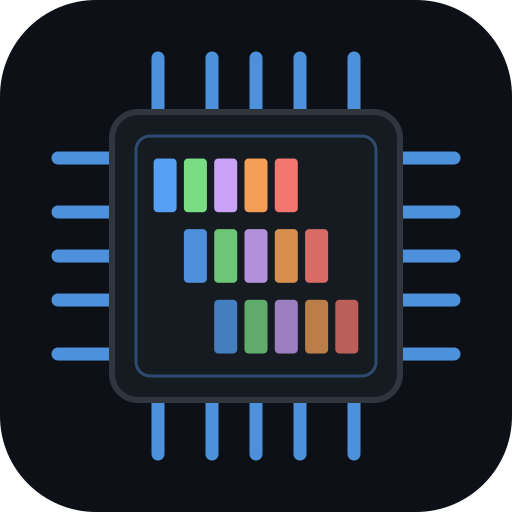
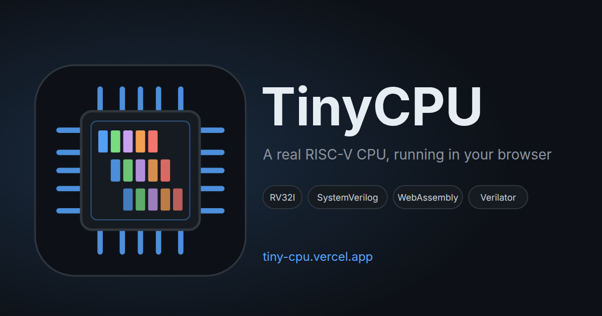
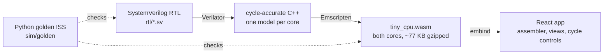

<div align="center">
  

  <h1>TinyCPU</h1>

  <p>
    <strong>A real, synthesizable RV32I RISC-V CPU in SystemVerilog,<br>
    compiled to WebAssembly and running live in your browser.</strong>
  </p>

  <p>
    A single-cycle core and a 5-stage pipelined core with forwarding and hazard handling.<br>
    Assemble a program in the browser, then step through every clock cycle: the pipeline, the registers, the memory, the console.
  </p>

  <p>
    <a href="LICENSE"></a>
    
    
    
    
    
    
  </p>

  <p>
    <a href="https://github.com/tinycomputers/tiny-cpu/actions/workflows/rtl.yml"></a>
    <a href="https://github.com/tinycomputers/tiny-cpu/actions/workflows/wasm.yml"></a>
    <a href="https://github.com/tinycomputers/tiny-cpu/actions/workflows/web.yml"></a>
    <a href="https://github.com/tinycomputers/tiny-cpu/actions/workflows/fpga.yml"></a>
  </p>

  <p>
    <a href="https://tiny-cpu.vercel.app"></a>
    &nbsp;
    <a href="https://tiny-cpu.vercel.app/docs/how-it-works"></a>
  </p>
</div>

---



**TinyCPU** is an open-source, educational **RISC-V processor** you can read, simulate, synthesize and watch run. The RTL is
written in **SystemVerilog** and is verified against the official `riscv-tests` suite and an independent Python golden model.
The same hardware is compiled to **WebAssembly** with Verilator and Emscripten, so the page you are reading can run it: no
JavaScript re-implementation of the CPU sits between you and the design.

> **Live:** [tiny-cpu.vercel.app](https://tiny-cpu.vercel.app). Write RV32I assembly, run it on either core, and step cycle by cycle.
> **Part of the Tiny series:** [TinyGPU](https://github.com/tinycomputers/tiny-gpu), [TinyTPU](https://github.com/tinycomputers/tiny-tpu), [TinyCompiler](https://tiny-compiler.vercel.app), [TinyAttention](https://tiny-attention.vercel.app).

---

## 📑 Contents

- [What is TinyCPU?](#-what-is-tinycpu)
- [Features](#-features)
- [How it works](#️-how-it-works)
- [Architecture](#-architecture)
- [Performance](#-performance)
- [Verification](#-verification)
- [FPGA](#-fpga)
- [Get started](#-get-started)
- [Repository layout](#-repository-layout)
- [Tech stack](#-tech-stack)
- [Documentation](#-documentation)
- [Roadmap](#️-roadmap)
- [The Tiny series](#-the-tiny-series)
- [FAQ](#-faq)
- [License](#-license)

---

## 🧠 What is TinyCPU?

TinyCPU implements the **RV32I base integer instruction set** of RISC-V, the open ISA used in embedded controllers, research
processors and teaching courses. It is small enough to read in an afternoon, and it is not a toy: it is a synthesizable design
that is checked instruction by instruction against a reference.

It is built for three audiences:

- **Students of computer architecture** who want to see a pipeline work, including what a forwarding path and a load-use stall
  actually do, cycle by cycle.
- **Hardware engineers** who want a readable, lint-clean, verified RISC-V core to study, extend or synthesize.
- **Anyone curious about RISC-V and CPUs** who wants to write a few lines of assembly and watch the processor execute them.

## ✨ Features

- **Two cores, one instruction set.** A single-cycle reference core and a classic **5-stage pipeline** (IF, ID, EX, MEM, WB).
- **Full RV32I** base integer instructions, plus the read-only `cycle`, `time`, `instret` counters (`rdcycle`, `rdinstret` and their high halves).
- **Hazard handling** in the pipeline: EX/MEM and MEM/WB **forwarding** into EX, a one-cycle **load-use stall**, and a two-cycle **branch flush**.
- **A runtime switch for forwarding** (`cfg_forward_en`), so you can compare the same program with and without it.
- **Browser assembler** that produces the same bytes as the GNU RISC-V toolchain (checked against GNU's output on 26 sources).
- **Live visualizer** with four views: the pipeline with its hazard flags, the single-cycle datapath with live operand values,
  a hazard lab that measures each hazard with forwarding on and off, and a programs comparison with a data-memory heatmap.
- **Five example programs** (hello world, Fibonacci, bubble sort, memcpy, prime sieve), each with a known answer.
- **FPGA build** for the Lattice iCE40UP5K (iCEBreaker), with a UART console and LED status.
- **Honest verification**: the official `riscv-tests`, random programs, fault cases, and mutation checks that break the design on purpose.

**Not included (yet):** interrupts, traps, privilege modes, the `M` (multiply/divide) and `C` (compressed) extensions, caches,
and misaligned loads and stores (the address is forced into alignment and flagged). The plan lists these as stretch goals.

## ⚙️ How it works



The core insight is that **the page does not simulate the CPU, the CPU runs in the page.** Verilator turns the RTL into C++
models of both cores. Emscripten compiles them into one WebAssembly module, which exposes every clock edge's state
(the five stages, the hazard flags, the registers, the retired instruction, the console) through a typed contract, documented in
[`docs/STATE_SCHEMA.md`](docs/STATE_SCHEMA.md). The app draws what the hardware reports and nothing else.

| What is real | Why it matters |
|:---|:---|
| **Real RTL.** `rtl/*.sv` is synthesizable SystemVerilog: `always_ff` and `always_comb`, no latches. The memories' `initial` blocks only zero them for simulation and load the FPGA image. | You can take it to an FPGA flow. |
| **Real WebAssembly.** The browser executes compiled hardware models, not a JavaScript re-implementation. | What you see is what the RTL does. |
| **Real signals.** Stages, hazards and registers come from debug ports on the top module. | Every number on screen traces to a hardware port. |

## 🏛️ Architecture

### Memory map

| Region | Address | Size | Notes |
|:---|:---|:---|:---|
| IMEM | `0x0000_0000` | 4 KiB | Loaded by the harness. Read-only to the core. |
| DMEM | `0x0001_0000` | 4 KiB | Byte-addressable: `LB`, `LH`, `LW`, `SB`, `SH`, `SW`. |
| `CONSOLE` | `0x0002_0000` | 1 word | A store prints its low byte in the console. |
| `TOHOST` | `0x0002_0004` | 1 word | Writing 1 reports PASS and halts the core. |
| `CYCLE` | `0x0002_0008` | 1 word | Reads the cycle counter. |

Instruction and data memory are separate ports (a Harvard design) that share one address space.

### The 5-stage pipeline

| Stage | What happens |
|:---|:---|
| **IF** | Fetch the instruction at the program counter. |
| **ID** | Decode it, read the source registers, generate the immediate. |
| **EX** | ALU operation, branch resolution, effective address. |
| **MEM** | Load from or store to data memory (or the MMIO registers). |
| **WB** | Write the result to the destination register. |

| Decision | Choice | Why |
|:---|:---|:---|
| Branch and jump resolution | In **EX**; predicted **not taken** | Simplest correct design. A taken branch costs a visible **two-cycle** flush. |
| Forwarding | **EX/MEM → EX** and **MEM/WB → EX**, for both operands | Hides most data hazards. Store data is forwarded too. |
| Load-use hazard | **One-cycle stall**, then forwarding | A load's value exists only after MEM. This is the only stall with forwarding on. |
| Register file | Write-first bypass in the pipeline; `x0` hard-wired to zero | Removes the WB-to-ID hazard; `rd = x0` never forwards. |
| Forwarding off (`cfg_forward_en = 0`) | The hazard unit stalls on **every** read-after-write hazard | Makes the cost of forwarding measurable on the same program. |
| Halt | `ecall`, `ebreak` or a `TOHOST` write | Clear end of run for tests and the app. |

### Single-cycle core

One instruction per cycle, so its CPI is exactly 1. It is the reference for what a program should do, and its memories are
combinational-read, which is why it is not the FPGA target.

## 📈 Performance

Cycle counts from the pinned baseline in [`sim/perf_baseline.json`](sim/perf_baseline.json). Each row is checked against the
independent timing model on every change.

| Program | Instructions | Single-cycle | Pipeline, forwarding | Pipeline, no forwarding |
|:---|---:|---:|---:|---:|
| `fib` (Fibonacci) | 3190 | 3190 | 4758 | 4824 |
| `hello` (prints a greeting) | 91 | 91 | 150 | 171 |
| `memcpy` (copy and check) | 552 | 552 | 816 | 1042 |
| `hazard_free/bubble_sort` | 749 | 749 | 863 | 863 |

Forwarding matters where instructions depend on each other closely: `memcpy` is 226 cycles faster with it. The app's **Hazard lab**
and **Programs** views show these numbers live.

## ✅ Verification

Each row is a check that runs on every change in continuous integration. Each one can fail, and the mutation checks deliberately break the design to confirm that.

| What | How much | Checked against |
|:---|:---|:---|
| Official RISC-V instruction tests (`rv32ui-p-*`) | **40 of 42**, both cores | Python golden ISS. `fence_i` and `ma_data` are excluded. |
| Hand-written programs | 5, both cores | Golden ISS for results; timing model for pipeline cycles |
| Random programs | **260**, both forwarding modes | Golden ISS for results; timing model for pipeline cycles |
| Fault cases | 13 | Golden ISS (illegal instructions, bad accesses, misaligned jumps) |
| Pipeline lockstep and hazard tests | 633 lockstep, 68 hazard | Golden ISS, retire by retire |
| Mutation checks | 7 on the pipeline, 11 on hazards | Each deliberate break must fail a test |
| WASM module | 534 checks | Golden fixtures on both cores, forwarding on and off |
| Web app | 74 unit tests, 18 browser tests | Assembler vs GNU bytes; the presets on the WASM core |
| Size budget | About 77 KB gzipped | The build fails above 400 KB |

The pipeline's cycle counts are checked against a **separate timing model** written in Python (`sim/golden/pipemodel.py`), so
the RTL and the model are two implementations of the same rules.

## 🔌 FPGA

The iCE40UP5K (iCEBreaker) build runs the pipelined core on a program preloaded into block RAM and prints its console over
a 115200-baud UART. Five LEDs show running, done, pass, fault and overflow. `bash fpga/ice40/build.sh` runs the flow:

| Resource | Used | Available |
|:---|---:|---:|
| Logic cells | 4958 | 5280 (93%) |
| Block RAM (4 Kbit) | 17 | 30 |

- **Clock:** 14.98 MHz after routing, above the 12 MHz oscillator.
- **Latches:** none. The build fails if Yosys produces one.
- **Simulation:** `bash sim/run.sh fpga` decodes the UART and checks the LEDs. It prints `6765` for `fib`.
- **Not yet:** the board is not tested. The UART and LED pins still need placing for the board. See [`fpga/README.md`](fpga/README.md).

## 🚀 Get started

### Use it in the browser

Open **[tiny-cpu.vercel.app/app](https://tiny-cpu.vercel.app/app/)**. Pick an example, press **Assemble & run**, and step through the cycles.

### Build and test from source

Toolchains are project-local, so nothing needs root. Bootstrap once:

```bash
bash .tools/setup.sh && bash .tools/emsdk.sh && bash .tools/riscv-gcc.sh   # Verilator 5.036, Emscripten, RISC-V GCC
git submodule update --init --depth 1                                       # sw/riscv-tests
python3 -m venv .venv && .venv/bin/pip install -r sim/requirements.txt
source scripts/env.sh
```

Then:

```bash
make -C sw all                              # build the riscv-tests and example programs
python -m pytest sim/golden -q              # the golden model and its tests
bash scripts/lint.sh                        # verilator -Wall, every module
bash sim/run.sh all                         # cocotb: unit, single-cycle and pipeline lockstep, FPGA UART
bash wasm/build.sh && node wasm/test.mjs    # the WebAssembly module and its checks
cd web && pnpm install && pnpm dev          # the web app at http://localhost:4321
```

Run one example through the golden model: `cd sim && python -m golden.cli run ../sw/build/programs/fib --trace-last 10`.

## 🗂️ Repository layout

| Path | Contents |
|:---|:---|
| `rtl/` | SystemVerilog: the single-cycle and 5-stage cores, the ALU, the decoder, the register file, the memories, the MMIO block |
| `sim/` | Golden ISS (`sim/golden/`), cocotb testbenches, example programs (`sim/programs/`), the cycle baseline |
| `sw/` | Linker script, startup code, the `riscv-tests` submodule and their build |
| `wasm/` | Verilator and Emscripten harness: `harness.cpp`, the build script, the Node test |
| `web/` | Astro and React app: the assembler, the views, the landing page, the docs pages |
| `fpga/` | iCE40 top level, constraints, the synthesis script, memory image generator |
| `docs/` | Plan, architecture, the state schema between the WASM module and the browser |

## 🧰 Tech stack

- **Hardware:** SystemVerilog (RTL), Verilator 5.036, cocotb, Yosys, nextpnr (iCE40)
- **Reference:** Python golden ISS and timing model, the official `riscv-tests` suite
- **Compiled to the browser:** Emscripten, WebAssembly, embind
- **Web app:** Astro, React, TypeScript, Tailwind CSS, Vitest, Playwright
- **CI:** GitHub Actions, one workflow per concern (RTL, WASM, web, FPGA, nightly)

## 📚 Documentation

- [How it works](https://tiny-cpu.vercel.app/docs/how-it-works): the chain from RTL to browser, and a first program to run
- [Architecture](https://tiny-cpu.vercel.app/docs/architecture): memory map, the two cores, the golden model
- [The pipeline](https://tiny-cpu.vercel.app/docs/the-pipeline): the five stages, step by step
- [Hazards](https://tiny-cpu.vercel.app/docs/hazards): data and control hazards, forwarding, stalls and flushes
- [Verification](https://tiny-cpu.vercel.app/docs/verification): what is tested, against what, and what is not verified yet
- [`docs/PLAN.md`](docs/PLAN.md): the full plan, phase by phase
- [`docs/ARCHITECTURE.md`](docs/ARCHITECTURE.md) and [`docs/STATE_SCHEMA.md`](docs/STATE_SCHEMA.md): design decisions and the browser contract

## 🗺️ Roadmap

- [x] Golden ISS and the official `riscv-tests` suite
- [x] Single-cycle RV32I core, verified in lockstep with the golden model
- [x] 5-stage pipeline, then forwarding, stalls and flushes, verified cycle for cycle
- [x] WebAssembly build with both cores in one module
- [x] Browser assembler, pipeline view, datapath view, hazard lab, programs comparison
- [x] Landing page, docs, social card
- [x] iCE40UP5K synthesis, UART and LED top level, 14.98 MHz post-route
- [ ] Board bring-up: place the UART and LED pins, generate a bitstream, print `fib` on a real iCEBreaker
- [ ] ECP5 target (ULX3S)
- [ ] Stretch: traps and interrupts, the `M` extension, a cache

## 🧬 The Tiny series

Each project is a small, verified, browser-runnable piece of computer hardware or hardware-software co-design.

| Project | What it is | Live |
|:---|:---|:---|
| [TinyCPU](https://github.com/tinycomputers/tiny-cpu) | A RISC-V RV32I CPU, single-cycle and 5-stage pipelined (this repo) | [tiny-cpu.vercel.app](https://tiny-cpu.vercel.app) |
| [TinyGPU](https://github.com/tinycomputers/tiny-gpu) | A small SIMT GPU simulator: threads, registers, memory, instructions | [docs](https://tinycomputers.github.io/tiny-gpu/) |
| [TinyTPU](https://github.com/tinycomputers/tiny-tpu) | A 4×4 systolic array in SystemVerilog, compiled to WebAssembly | [tiny-tpu.vercel.app](https://tiny-tpu.vercel.app) |
| [TinyCompiler](https://github.com/tinycomputers/tiny-compiler) | One tensor program compiled to TinyGPU and TinyTPU, checked against numpy | [tiny-compiler.vercel.app](https://tiny-compiler.vercel.app) |
| [TinyAttention](https://github.com/tinycomputers/tiny-attention) | A synthesizable FlashAttention engine, verified bit-exact | [tiny-attention.vercel.app](https://tiny-attention.vercel.app) |

## ❓ FAQ

**What is RV32I?** The 32-bit base integer instruction set of RISC-V: 47 instructions for arithmetic, logic, shifts,
comparisons, branches, jumps, loads, stores and system instructions. TinyCPU implements the arithmetic, logic, branch, jump,
load and store instructions. `ecall` and `ebreak` halt the core rather than entering a trap handler, because TinyCPU has no traps.

**Is it synthesizable?** Yes. The RTL is written to be synthesized, and the iCE40 build runs Yosys and nextpnr with a latch
check. It fits the iCE40UP5K at 93% of its logic cells, and runs at 14.98 MHz after routing.

**Does it run on real hardware?** Not yet. The FPGA build is verified in simulation and synthesizes cleanly. Board bring-up is
the next step on the roadmap.

**How is it verified?** Against the official RISC-V instruction tests and a Python golden model, instruction by instruction,
plus random programs and mutation checks. See [Verification](#-verification).

**Why does the browser run the real hardware?** Verilator compiles the RTL to C++, and Emscripten compiles that to
WebAssembly. The browser executes the compiled design, and the app reads its signals.

**Can I use it to learn pipelining?** That is the main goal. Run the same program with forwarding on and off, and watch the
Hazard lab explain each stall and flush.

**What license is it under?** MIT. See [LICENSE](LICENSE).

## 📄 License

MIT. See [LICENSE](LICENSE).
